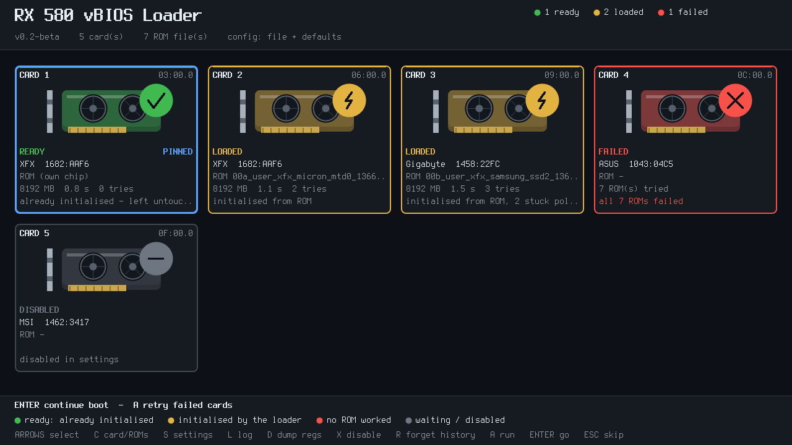
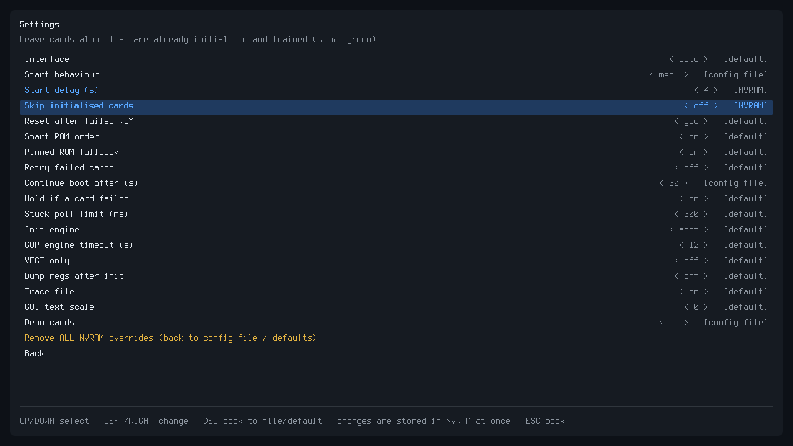

# RX 580 vBIOS Loader

A UEFI application for initializing AMD Polaris GPUs when a card's SPI vBIOS is unavailable or cannot be read reliably. It loads user-supplied ROMs before Linux starts and can expose the selected vBIOS images to Linux through ACPI/VFCT.

> **Firmware warning:** An incompatible vBIOS can prevent a GPU from initializing or hang the system. Prefer a complete dump from the exact card. This project does not include vBIOS, SPI dumps, GOP images, or other vendor firmware.

## Preview

| Status | Settings |
|---|---|
|  |  |

## Quick start

These steps are for Debian/Ubuntu systems booted in UEFI mode, with the EFI System Partition mounted at `/boot/efi`.

### 1. Download and build

```bash
git clone https://github.com/aryan-nikzad/rx580_vbios_loader_GUI.git && cd rx580_vbios_loader_GUI && sudo apt update && sudo apt install -y build-essential gnu-efi efibootmgr && make
```

### 2. Add your ROM file

Create `vbioses/` in the project directory and copy your compatible `.rom` file into it:

```bash
mkdir -p vbioses && cp /path/to/your_card.rom vbioses/
```

A **complete SPI dump from the same card** is preferred when available. Do not trim a full SPI dump to the smaller BIOS image. If you do not have your own dump, see [the community RX 580 dump collection](https://github.com/aryan-nikzad/rx580_dumps) below; third-party ROMs are compatibility candidates, not universal images.

### 3. Install

```bash
sudo sh install_linux.sh
```

The installer copies the loader and `vbioses/` to `EFI/vbios_loader/` on the EFI System Partition and creates a UEFI boot entry named **RX580 loader**, placing it first in the boot order. Reboot to start the loader.

**Before installing:** confirm that the machine is booted in UEFI mode and the EFI partition is mounted at `/boot/efi`. If it is mounted elsewhere, pass its mount path, for example: `sudo env ESP=/your/efi/path sh install_linux.sh`.

### 4. Configure each card once

The status screen detects the GPUs. To assign a ROM manually, use the arrow keys to select a card, press **C**, select a ROM, then press **P** to pin it to that card. Repeat for each GPU. The assignment is saved in UEFI NVRAM, so the loader can use it automatically on later boots.

Press a key during the startup countdown to keep the menu open. Press **ENTER** or **A** to continue with AUTO.

---

## Controls

| Key | Action |
|---|---|
| Arrow keys | Select a GPU |
| **ENTER / A** | Start AUTO / continue boot |
| **C** | Open the selected card |
| **P** | Pin the selected ROM to the card |
| **U** | Unpin the card |
| **S** | Open settings |
| **L** | View the log |
| **D** | Dump registers |
| **X** | Disable or enable the selected card |
| **F** | Force initialization / return to normal detection |
| **R** | Forget remembered ROMs and per-ROM results |
| **ESC** | Skip the loader before its run |

## ROM files and selection

Place ROM files in the project's `vbioses/` directory before installation. The installer copies this directory to the EFI partition.

- A pinned ROM is tried first for its assigned card.
- Without a pin, the loader uses its remembered working ROM and then its normal search order.
- With `smart_order=1`, filenames containing brands such as `xfx`, `gigabyte`, `asus`, `msi`, or `sapphire` are preferred.
- Different GPUs can have different ROM assignments. Use the PCI address shown by the loader to identify each card.

Example layout:

```text
rx580_vbios_loader_GUI/
├── vbioses/
│   ├── 00_xfx_original.rom
│   ├── 01_gigabyte_original.rom
│   └── 02_fallback.rom
├── vbios_loader.efi
└── install_linux.sh
```

File names only affect selection order; they do not make an incompatible ROM safe or compatible.

### Community ROM collection

The companion [rx580_dumps repository](https://github.com/aryan-nikzad/rx580_dumps) contains XFX RX 580 SPI dumps and a Gigabyte RX 580 dump that has also been tested with an XFX card in this project. You can copy its entire `vbioses/` directory into this project's root, next to `install_linux.sh`; the installer will copy it to the EFI partition.

These dumps are not universal. Before using a ROM on another card, check the exact board, VRAM capacity, memory vendor/type, subsystem ID, and BIOS version. Prefer your own original full SPI dump whenever possible. Keep private dumps out of Git.

## Linux runtime power management

On affected cards, Linux may later attempt to power-cycle or reinitialize a GPU whose physical SPI vBIOS is unavailable. This can cause a freeze during desktop startup even if the UEFI loader initialized the GPU successfully.

If this happens, try disabling AMD GPU runtime power management with the kernel parameter `amdgpu.runpm=0`:

1. Edit `/etc/default/grub` and add `amdgpu.runpm=0` inside the existing `GRUB_CMDLINE_LINUX_DEFAULT` value. Preserve any parameters already there.
2. Run `sudo update-grub && sudo reboot`.
3. After reboot, verify with `cat /sys/module/amdgpu/parameters/runpm`; the expected value is `0`.

This is a workaround for a runtime power-management/reinitialization limitation, not a universal fix. Suspend/resume, GPU resets, or unloading/reloading `amdgpu` may still require reinitialization and fail on affected cards.

## Multi-GPU systems

- Enable **Above 4G Decoding** in the motherboard firmware when using multiple GPUs.
- Assign and pin a ROM for each card where necessary.
- The loader processes cards individually and can leave a card untouched when it detects that the GPU is already initialized and memory-trained.
- The loader can publish the selected ROMs to Linux through ACPI/VFCT.

Results depend on the GPU, ROM, motherboard firmware, and current card state. Low-level initialization with an incompatible ROM can hang or reset the machine.

### Optional Linux kernel patch for mixed vBIOS sources

Patch directory: [`vfct/`](https://github.com/aryan-nikzad/rx580_vbios_loader_GUI/tree/main/vfct)  
Patch file: [Prefer an exact PCI bus match when selecting a VFCT entry](https://github.com/aryan-nikzad/rx580_vbios_loader_GUI/blob/main/vfct/0001-drm-amdgpu-prefer-exact-bus-match-when-selecting-VFC.patch)

This patch is optional, is not part of the loader, and is relevant only to systems affected by incorrect VFCT entry selection.

**What it changes:** Linux normally tries its standard vBIOS acquisition paths first, which can include reading the card's physical SPI flash. VFCT is a fallback source when the normal path does not provide a usable BIOS. The patch does not change that source order; it changes matching order within VFCT:

1. Search for an entry matching the current GPU's PCI bus number and device identity (vendor, device, slot, and function).
2. If no exact-bus match exists, retain the kernel's original identity-based fallback, which can accept an entry whose recorded bus number differs.

Without the first pass, the driver may stop at an earlier VFCT entry for another GPU with the same device identity, even when a correct entry for the current bus appears later in the table.

The reported reproduction involved two RX 580 / Polaris 10 cards from different board vendors on an ASUS B250 mining motherboard. VFCT contained entries for bus 1 and bus 12, but the card at bus 12 received the bus 1 vBIOS. A wrong board's vBIOS can contribute to initialization errors such as `UVD not responding` or a fatal GPU initialization error.

This is a targeted workaround, not proof that all mixed SPI/VFCT failures have the same cause. It modifies Linux kernel `amdgpu` code, not the loader. Review the patch, apply it to a compatible kernel source tree, and rebuild/install the kernel as appropriate for your distribution. Kernel versions may differ, so the patch may need adjustment or may not apply cleanly. Keep a known-working kernel available before testing.

## Troubleshooting

### The system freezes after the loader initializes the GPUs

- Check whether `amdgpu.runpm=0` is set and verify the value as described above.
- Avoid suspend/resume, GPU resets, or unloading/reloading `amdgpu` on affected cards; these can trigger a new initialization path.
- If only a particular card fails, verify its ROM assignment and hardware identity.

### A ROM fails to initialize a card

Prefer the card's own complete SPI dump. If testing another ROM, verify:

- exact board/model and subsystem ID;
- VRAM capacity and memory vendor/type;
- BIOS version and board compatibility;
- that the file is a complete dump when a full SPI dump is available.

### The installer cannot find the EFI partition

Make sure the system was booted in UEFI mode and that the EFI System Partition is mounted. The default path is `/boot/efi`; for another mount point, set `ESP` when running the installer.

## Installed files

The installer places files under `EFI/vbios_loader/` on the EFI System Partition:

```text
EFI/vbios_loader/
├── vbios_loader.efi
├── vbios_loader.cfg
└── vbioses/
    └── *.rom
```

An existing `vbios_loader.cfg` on the EFI partition is preserved. If no configuration exists, the installer can copy `vbios_loader.cfg.example` as the initial configuration. Trace and diagnostic files may also be written in this directory.

## Development

See [AGENTS.md](AGENTS.md) for architecture notes, development workflow, build rules, and firmware-handling requirements.

## Licensing

- Project code: [MIT License](LICENSE).
- AMD AtomBIOS-derived code in `atomlib/`: see [LICENSES-AMD-ATOMBIOS.txt](LICENSES-AMD-ATOMBIOS.txt).
- Terminus-derived bitmap font: see [LICENSES-FONT-TERMINUS.txt](LICENSES-FONT-TERMINUS.txt).
- vBIOS dumps, SPI images, GOP images, and other vendor firmware are excluded and are **not covered** by the project's MIT license.

## Credits

Created by **Reza Nikzad**, with assistance from Claude (Anthropic) and ChatGPT (OpenAI).
